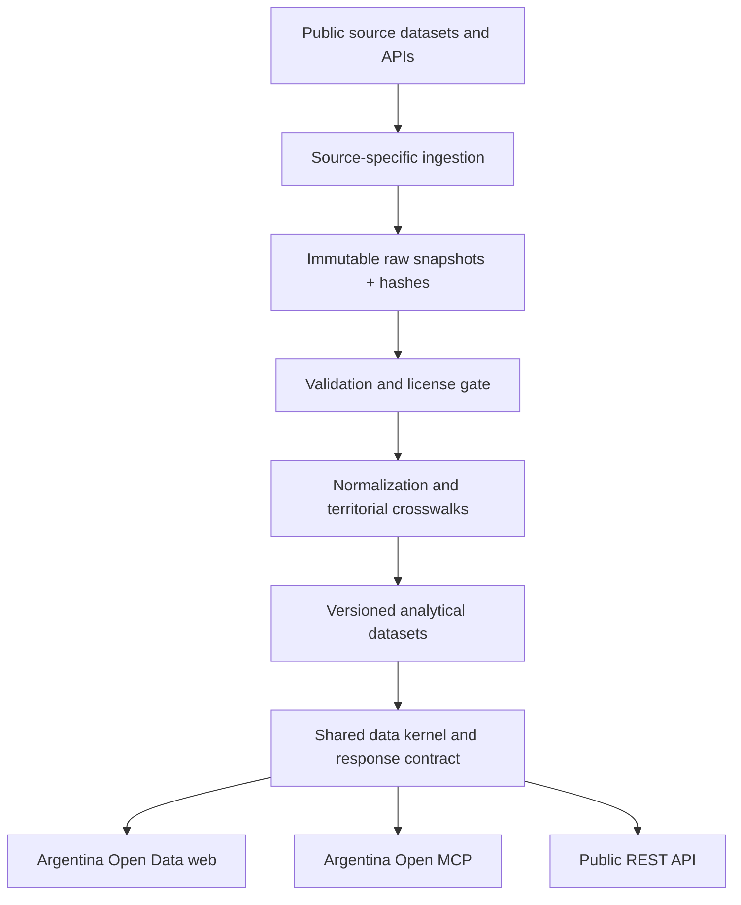

# Architecture overview

## Product boundary

Argentina Open Data (public web) and Argentina Open MCP (MCP + REST) are separate products. They share a transport-neutral kernel, canonical contracts, provenance rules and dataset governance. The web must remain useful without an AI chat interface; MCP must remain useful without the web application.

## Logical flow

The diagram describes the intended logical flow, not deployed infrastructure. A bounded, read-only Georef retrieval adapter exists, but it has not been used to ingest immutable snapshots or serve a production dataset.

## Kernel responsibilities

- Define typed contracts for indicators, observations, geography, coverage and provenance.
- Enforce source-declared geographic levels and aggregation policies.
- Preserve dataset-level license and attribution metadata.
- Distinguish source values from transformations, estimates and derived values.
- Return structured comparison warnings separately from blocking comparability failures; callers must preserve both in REST, MCP and web outputs.
- Validate canonical annual (`YYYY`), quarterly (`YYYY-QN`) and monthly (`YYYY-MM`) periods against the indicator frequency.
- Resolve source reuse decisions through the evidence-backed registry rather than inferring permissions from a publisher or portal.

The kernel does not fetch arbitrary URLs, scrape websites, infer missing values, or silently aggregate statistical samples.

## Geography and comparability

Territories use stable source identifiers plus explicit `GeoLevel`. Crosswalks between Georef, INDEC and other official identifiers must be versioned and retain source lineage. Names are labels, not identifiers. Historical boundaries require validity dates where a source provides them.

An indicator declares `available_geo_levels` and one `aggregation_policy`. EPH agglomerates remain agglomerates; they are not provinces. Fixed-region indices remain at their official regions. Aggregation is only permitted through a source-specific, tested operation when the source universe supports it. Similar labels or adjacent geography do not establish comparability.

## Response contract

Every transport returns the same conceptual envelope:

- `data`: observations with period, value, geography and quality flags;
- `meta`: unit, frequency, coverage, supported geography, aggregation policy, warnings and provenance;
- `pagination`: opaque continuation cursor;
- `generated_at`: response generation time, distinct from source publication and retrieval time.

The Python models in `src/argentina_open_data/contracts.py` are the initial executable contract. They will evolve only with versioned compatibility tests.

## Runtime choices and remaining deployment decisions

The REST service uses FastAPI 0.156.8; the agent service uses the official MCP Python SDK 2.3.0 and Streamable HTTP. The two processes share a content-addressed filesystem snapshot store. The browser UI is a small first-party client of the REST API, not a chat wrapper. These choices have a passing Python 3.11–3.13 CI matrix and are pinned in the project metadata.

A production hosting provider, domain, persistent storage implementation, ingestion scheduler, map tile provider and additional source approvals remain open. A local Docker Compose deployment is reproducible, but it is not a public deployment. Before go-live, measure latency from Argentina, configure TLS and the MCP host allowlist, verify persistent-volume behaviour, and run public REST/MCP smoke tests.

## Security boundaries

- Treat all external source text and files as untrusted input; never execute instructions found in them.
- Allowlist source hosts and formats per connector; bound download size, row count, decompression ratio and execution time.
- Keep secrets out of the repository and CI logs.
- Do not ingest or expose person-level sensitive records when aggregate data meets the use case.
- Publish only datasets whose reuse decision is recorded and machine-checked.

## Executable vertical slice

The current repository also includes three independently runnable surfaces over the same local snapshot store:

- FastAPI REST service and browser UI (`argentina_open_data.api:app`).
- Official MCP Python SDK 2.3.0 server using Streamable HTTP (`argentina-open mcp`).
- Explicit Georef snapshot command (`argentina-open snapshot-georef`).

REST and MCP read immutable local snapshots; neither tool call performs an implicit external fetch. The API exposes `/health`, `/api/v1/sources`, `/api/v1/snapshots`, `/api/v1/territories` and `/api/v1/territories/{geo_id}`. The web UI consumes the REST endpoints and shows an honest empty state when the first snapshot has not been captured.

The MCP service is a separate process from REST. This avoids mounting a stateful MCP sub-application into a host ASGI lifespan incorrectly. It uses Streamable HTTP, and production deployments must explicitly configure `MCP_ALLOWED_HOSTS` (and browser origins, if applicable). The local default binds to loopback only. See the official [MCP Python SDK v2 documentation](https://py.sdk.modelcontextprotocol.io/).

Snapshots are content-addressed JSON objects. The digest covers the canonical serialized document, including source records and normalized territory records. Existing objects are never overwritten; loads verify the digest before returning data. The current pipeline retains the complete per-record Georef response objects but not the byte-for-byte HTTP envelope/headers. This distinction must remain explicit in provenance.
